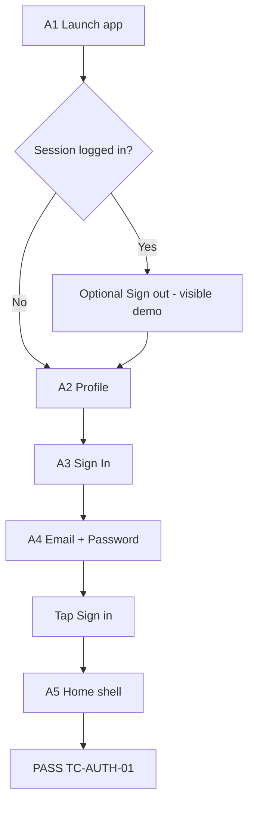
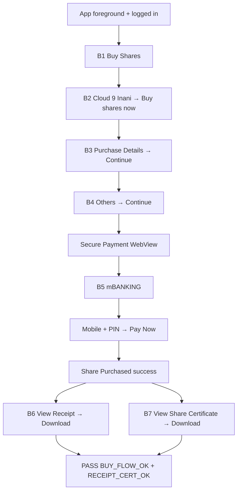
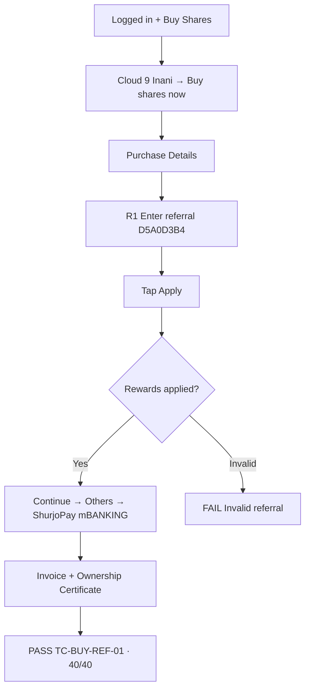
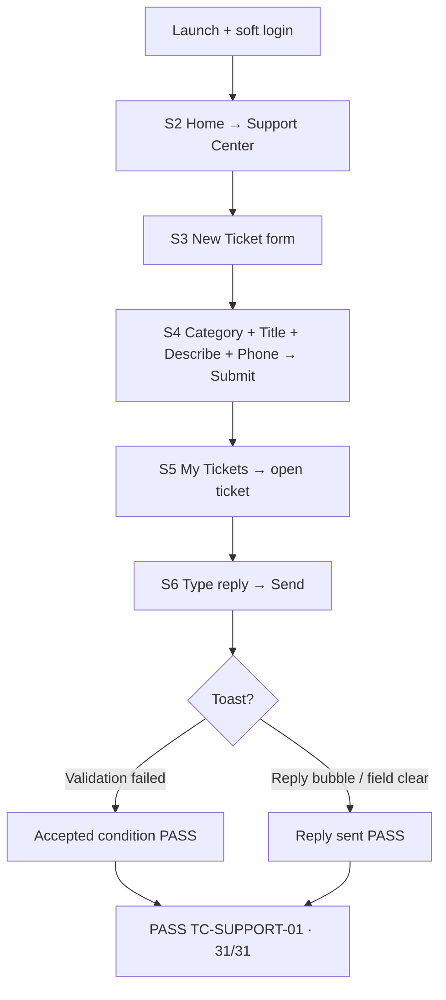

# Aungsha Mobile App — Flow Documentation

> End-to-end **UI automation** flows, test cases, test data, and screen/gateway touchpoints for the Aungsha Android app.

[](#)
[](#)
[](#)
[](#)

| | |
|---|---|
| **Document type** | Flow / Test Design Spec |
| **Application** | Aungsha (`com.aungsha.app`) |
| **App version under test** | `aungsha_8oct.apk` (`apps/aungsha_8oct.apk`) |
| **Automation stack** | Appium 2 · UiAutomator2 · WebdriverIO · Mocha |
| **Primary device** | Emulator `emulator-5554` (AVD: `Aungsha_Emu`) |
| **Document version** | `2.0` |
| **Last updated** | 2026-10-13 |

---

## Run commands (copy-paste)

> Use **`npm.cmd`** on Windows PowerShell (avoids `npx` execution-policy errors).

### 1) Appium (Terminal A — keep running)

```powershell
cd e:\Aungsha-Mobile-App-Automation-Test
npm.cmd run appium
```

### 2) Emulator (if not already open)

```powershell
& "$env:LOCALAPPDATA\Android\Sdk\emulator\emulator.exe" -avd Aungsha_Emu -gpu swiftshader_indirect
```

### 3) Login test

```powershell
cd e:\Aungsha-Mobile-App-Automation-Test
npm.cmd run test:login
```

### 4) Buy flow (Cloud 9 + mBanking + Receipt / Certificate) — one command

```powershell
cd e:\Aungsha-Mobile-App-Automation-Test
$env:MBANKING_NUMBER = "01772559986"
$env:MBANKING_PIN = "1234"
npm.cmd run test:buy:script
```

### 5) Buy flow via WDIO Mocha spec (`tests/buy-flow.test.js`)

```powershell
cd e:\Aungsha-Mobile-App-Automation-Test
$env:MBANKING_NUMBER = "01772559986"
$env:MBANKING_PIN = "1234"
npm.cmd run test:buy
```

### 6) Receipt + Certificate only

```powershell
cd e:\Aungsha-Mobile-App-Automation-Test
npm.cmd run test:receipt
```

### 7) Withdrawal (Fund → bKash, skip buy)

```powershell
cd e:\Aungsha-Mobile-App-Automation-Test
$env:SKIP_BUY = "1"
$env:WITHDRAW_BKASH_NUMBER = "01772559986"
$env:WITHDRAW_AMOUNT = "500"
npm.cmd run test:withdraw:script
```

### 8) Fund-balance project buy (wallet + SurjoPay/mBANKING)

```powershell
cd e:\Aungsha-Mobile-App-Automation-Test
$env:WALLET_AMOUNT = "500"
$env:MBANKING_NUMBER = "01772559986"
$env:MBANKING_PIN = "1234"
npm.cmd run test:buy:fund:script
```

### 9) Marketplace SurjoPay project buy + Invoice / Ownership Certificate

```powershell
cd e:\Aungsha-Mobile-App-Automation-Test
$env:MBANKING_NUMBER = "01772559986"
$env:MBANKING_PIN = "1234"
npm.cmd run test:buy:marketplace:surjoypay
```

### 10) Checkout referral rewards + project buy (code `D5A0D3B4`)

```powershell
cd e:\Aungsha-Mobile-App-Automation-Test
$env:REFERRAL_CODE = "D5A0D3B4"
$env:MBANKING_NUMBER = "01772559986"
$env:MBANKING_PIN = "1234"
npm.cmd run test:buy:referral
```

### 11) Support ticket (New Ticket + reply)

```powershell
cd e:\Aungsha-Mobile-App-Automation-Test
npm.cmd run test:support:ticket
```

| Goal | Command |
|------|---------|
| Start Appium | `npm.cmd run appium` |
| Login | `npm.cmd run test:login` |
| Buy + receipt (script) | `npm.cmd run test:buy:script` |
| Buy WDIO | `npm.cmd run test:buy` |
| Fund-balance buy | `npm.cmd run test:buy:fund:script` |
| Marketplace SurjoPay + Invoice/Ownership Cert | `npm.cmd run test:buy:marketplace:surjoypay` |
| Checkout referral rewards buy | `npm.cmd run test:buy:referral` |
| Support ticket (new + reply) | `npm.cmd run test:support:ticket` |
| Receipt only | `npm.cmd run test:receipt` |
| Withdraw (skip buy) | `npm.cmd run test:withdraw:script` |

---

## Table of contents

1. [Overview](#1-overview)
2. [Repository structure](#2-repository-structure)
3. [Architecture](#3-architecture)
4. [Scope at a glance](#4-scope-at-a-glance)
5. [Prerequisites & setup](#5-prerequisites--setup)
6. [How to run](#6-how-to-run)
7. [Flow endpoints (UI / gateway)](#7-flow-endpoints-ui--gateway)
8. [Verified / passed endpoints](#8-verified--passed-endpoints)
9. [Flow diagrams](#9-flow-diagrams)
10. [Test cases](#10-test-cases)
11. [Best / required test data](#11-best--required-test-data)
12. [Detailed step catalogue](#12-detailed-step-catalogue)
13. [Locators & page objects](#13-locators--page-objects)
14. [Artifacts & logs](#14-artifacts--logs)
15. [Pass / fail criteria](#15-pass--fail-criteria)
16. [Defects, risks & known issues](#16-defects-risks--known-issues)
17. [Staging checklist (for developers)](#17-staging-checklist-for-developers)
18. [Extending the suite](#18-extending-the-suite)
19. [Document control](#19-document-control)

---

## 1. Overview

### 1.1 Purpose

This document is the **single source of truth** for:

- What **flows** are automated
- How many **endpoints** (screens / gateway entry points) exist in those flows
- Which **test cases** are implemented vs backlog
- What **best test data** to use (sandbox only)
- How to **run**, **debug**, and **extend** tests

### 1.2 Important note about “endpoints”

This repo is **mobile UI E2E automation**, not a backend API test pack.

| Term in this doc | Meaning |
|------------------|---------|
| **Endpoint** | A user-journey **screen** or **payment gateway** step the automation interacts with |
| **Backend API** | Not listed here (embedded in the Flutter/Android app; not exposed as OpenAPI in this repo) |

### 1.3 Goals

| Goal | Description |
|------|-------------|
| Regression | Login + buy shares path stay green on emulator |
| Sandbox safety | Payments use **mBanking sandbox** only |
| Traceability | Cases map to steps, data, and pass criteria |
| GitHub-ready | Clear TOC, tables, diagrams for PR / wiki use |

---

## 2. Repository structure

```text
Aungsha-Mobile-App-Automation-Test/
├── FLOW_DOCUMENTATION.md          ← this file
├── package.json                   ← npm scripts (test:login, test:buy, appium)
├── wdio.conf.js                   ← WebdriverIO config
├── .env                           ← secrets/config (do not commit real prod secrets)
│
├── pages/                         ← Page Object Model (like Playwright pages/)
│   ├── BasePage.js
│   ├── LoginPage.js
│   ├── HomePage.js
│   ├── MarketplacePage.js
│   ├── ProjectBuyPage.js
│   ├── PaymentGatewayPage.js
│   ├── ReceiptPage.js
│   └── WithdrawPage.js
│
├── services/                      ← flows + driver + config (like Playwright services/)
│   ├── AppConfig.js
│   ├── DriverManager.js
│   ├── SessionFactory.js
│   ├── Checkpoint.js
│   ├── BuyFlowComponent.js
│   ├── WithdrawFlowComponent.js
│   ├── BaseFlowComponent.js
│   └── runStandaloneFlow.js
│
├── tests/                         ← WDIO / Mocha specs
│   ├── login-flow.test.js         ← TC-AUTH-01
│   ├── buy-flow.test.js           ← TC-BUY-01
│   ├── buy-bkash.test.js
│   └── helpers/describeBuyFlow.js
│
├── scripts/                       ← thin CLIs only
│   ├── withdrawal-flow.js
│   ├── project-buy-*.js / fund-balance-*.js
│   ├── download-receipt-cert.js
│   ├── run-pom-buy.js / run-with-banner.js
│   ├── tools/                     ← inspect-device, _ui-labels
│   └── legacy/                    ← explore/dump/fill helpers
│
├── artifacts/                     ← screenshots + logs (gitignored)
├── apps/
│   ├── locators/
│   └── downloads/
├── .cursor/skills/
└── wdio.conf.js / package.json / .env
```

### 2.1 npm scripts

| Script | Command | Purpose |
|--------|---------|---------|
| `appium` | `npm.cmd run appium` | Start Appium on `127.0.0.1:4723` |
| `test:login` | `npm.cmd run test:login` | Run login WDIO spec (POM) |
| `test:buy` | `npm.cmd run test:buy` | Run buy WDIO POM spec |
| `test:buy:script` | `npm.cmd run test:buy:script` | Legacy node script (non-POM) |
| `test:buy:wdio` | `npm.cmd run test:buy:wdio` | Alias of `test:buy` |

> **Windows tip:** Prefer `npm.cmd` over `npx` if PowerShell blocks `.ps1` scripts.

---

## 3. Architecture

```text
┌─────────────────────────────────────────────────────────┐
│  Mocha / WDIO specs   (tests/*.js)                      │
└───────────────────────────┬─────────────────────────────┘
                            │
┌───────────────────────────▼─────────────────────────────┐
│  Page Objects           (pages/*)                       │
│  BasePage → LoginPage / HomePage / Marketplace / Buy    │
└───────────────────────────┬─────────────────────────────┘
                            │
┌───────────────────────────▼─────────────────────────────┐
│  DriverManager + AppConfig                              │
│  capabilities, package/activity, .env                   │
└───────────────────────────┬─────────────────────────────┘
                            │
┌───────────────────────────▼─────────────────────────────┐
│  Appium 2 + UiAutomator2  →  Android Emulator / Device  │
│  Aungsha app  →  (Secure Payment WebView) ShurjoPay     │
└─────────────────────────────────────────────────────────┘
```

**Design rules**

- Locators live in **page objects**, not scattered in raw tests (where POM is used)
- Prefer `mobile: clickGesture` / `mobile: type` for Flutter widgets
- Buy E2E lives mainly in `scripts/project-buy-flow.js` for reliability and logging

---

## 4. Scope at a glance

| Metric | Count | Details |
|--------|------:|---------|
| Automated suites | **7** | Auth · Buy · Fund-balance · Marketplace SurjoPay · Referral checkout · Withdrawal · Support ticket |
| Automated test cases | **7** | TC-AUTH-01 · TC-BUY-01 · TC-BUY-FUND-01 · TC-BUY-MKT-01 · TC-BUY-REF-01 · TC-WITHDRAW-01 · TC-SUPPORT-01 |
| Documented UI flows | **7** | Login · Buy · Wallet · Marketplace+Invoice · Referral `D5A0D3B4` · Withdraw · Support ticket |
| UI / gateway endpoints | **24** | 5 auth + 7 buy/pay/docs + 1 referral + 5 withdraw + 6 support |
| **Endpoints verified PASS** | See [§8](#8-verified--passed-endpoints) — all latest suites **PASSED** (login–referral/withdraw 2026-10-12 · support 2026-10-13) |
| Payment methods automated | **1** buy + **1** withdraw | Buy: mBANKING · Withdraw: **bKash** |
| Projects exercised | **1** | **Cloud 9 (Inani)** |
| Backlog cases (recommended) | **6** | See §10.2 |

---

## 5. Prerequisites & setup

### 5.1 Tooling

| Tool | Requirement |
|------|-------------|
| Node.js | LTS recommended |
| Android SDK | `platform-tools`, emulator |
| Appium | 2.x + `uiautomator2` driver |
| AVD | e.g. `Aungsha_Emu` |

### 5.2 App under test

| Key | Value |
|-----|-------|
| Package | `com.aungsha.app` |
| Activity | `com.aungsha.app.MainActivity` |
| Sample build | `apps/aungsha-tablet-staging.apk` |

### 5.3 First-time install

```powershell
cd e:\Aungsha-Mobile-App-Test
npm.cmd install
```

Copy / edit `.env` (see [§10.4](#104-environment-variables-env)).

---

## 6. How to run

### 6.1 Start Appium (Terminal A)

```powershell
cd e:\Aungsha-Mobile-App-Test; npm.cmd run appium
```

### 6.2 Start emulator (if needed)

```powershell
& "$env:LOCALAPPDATA\Android\Sdk\emulator\emulator.exe" -avd Aungsha_Emu
```

### 6.3 Run tests (Terminal B)

```powershell
# Login only
cd e:\Aungsha-Mobile-App-Test; npm.cmd run test:login

# Buy + receipt + share certificate (one command)
cd e:\Aungsha-Mobile-App-Test; npm.cmd run test:buy
```

### 6.4 Optional visibility

| Variable | Effect |
|----------|--------|
| `STEP_PAUSE_MS=1800` | Pause between login UI steps (easier to watch on emulator) |
| `STEP_PAUSE_MS=0` | Fastest login |
| `FORCE_APP_INSTALL=1` | Reinstall APK from `APP_PATH` on session start |

---

## 7. Flow endpoints (UI / gateway)

**Total: 24 endpoints** (A1–A5 · B1–B7 · R1 · W1–W5 · S1–S6)

### 7.1 Authentication flow — 5 endpoints

| ID | Endpoint (screen) | Actor action | Expected result |
|----|-------------------|--------------|-----------------|
| **A1** | App launch | Cold / warm start | `com.aungsha.app` in foreground |
| **A2** | Profile | Open Profile tab | Profile UI |
| **A3** | Sign In entry | Tap **Sign In** | Login form |
| **A4** | Email login form | Email + password → **Sign in** | Auth request succeeds |
| **A5** | Home (authenticated) | Land on Home | `Buy Shares` / `Marketplace` / `Net Worth` |

### 7.2 Buy · payment · documents — 7 endpoints

| ID | Endpoint (screen / gateway) | Actor action | Expected result |
|----|----------------------------|--------------|-----------------|
| **B1** | Buy Shares tab | Open tab | Project cards list |
| **B2** | Cloud 9 (Inani) detail | Card → **Buy shares now** | Purchase Details |
| **B3** | Purchase Details | **Continue** | Choose payment method |
| **B4** | Payment method | **Others (VISA + more)** → **Continue** | Secure Payment WebView |
| **B5** | ShurjoPay → **mBANKING** | Mobile + PIN → Pay Now | Sandbox payment accepted |
| **B6** | Success → View Receipt / Invoice | Open + Download | Receipt or `invoice.png` |
| **B7** | Success → Share / Ownership Certificate | Open + Download | Certificate or `ownership-certificate.png` |

### 7.2a Referral rewards — 1 endpoint

| ID | Endpoint (screen) | Actor action | Expected result |
|----|-------------------|--------------|-----------------|
| **R1** | Purchase Details → Referral | Enter code **`D5A0D3B4`** → **Apply** | Referral rewards applied (no Invalid dialog) |

### 7.3 External gateway detail

| Gateway | When it appears | Tabs | Automated path |
|---------|-----------------|------|-----------------|
| **ShurjoPay** WebView | After Others → Continue | CARDS · **mBANKING** · iBANKING | mBANKING |
| Mobile Number field | mBANKING form | `#input-38` (`maxlength=11`) | `01772559986` |
| Pin Number field | mBANKING form | `#input-41` | `1234` |
| Pay control | Form complete | `button.paynow_btn` | Click when enabled |

### 7.4 Payment options on app (not all automated)

| Method | UI label (approx.) | Automated? |
|--------|--------------------|------------|
| bKash | Recommended · fee shown | No (backlog) |
| Others | VISA + more · fee shown | **Yes** → ShurjoPay |

### 7.5 Withdrawal — 5 endpoints

| ID | Endpoint (screen) | Actor action | Expected result |
|----|-------------------|--------------|-----------------|
| **W1** | Skip buy / activate | Foreground app | Home reachable |
| **W2** | Home → Fund | Open Fund / wallet | Fund screen |
| **W3** | Fund Withdraw CTA | Tap Withdraw ImageView | Withdraw screen |
| **W4** | bKash method | Select number → Continue | Amount screen |
| **W5** | Amount + Submit | Enter ৳500 → Submit | Withdrawal submitted |

### 7.6 Support ticket — 6 endpoints

| ID | Endpoint (screen) | Actor action | Expected result |
|----|-------------------|--------------|-----------------|
| **S1** | Soft login / Home shell | Launch + soft login | Home markers / already logged in |
| **S2** | Home → Support Center | Tap Support tile | Support Center open |
| **S3** | New Ticket form | Tap New Ticket | Create form (EditTexts) open |
| **S4** | Fill + Submit | Category Account · Title · Describe · Phone → Submit | Ticket created |
| **S5** | My Tickets → open card | Open newest / matching title | Ticket chat open |
| **S6** | Reply message | Type reply → Send | Reply sent **or** `Validation failed` toast (accepted condition) |

---

## 8. Verified / passed endpoints

> Latest evidence: **2026-10-12** (buy/login/withdraw) + **2026-10-13** (support) on `emulator-5554` / AVD `Aungsha_Emu`.  
> Commands: `test:login` · `test:buy` · `test:buy:fund:script` · `test:buy:marketplace:surjoypay` · `test:buy:referral` · `test:withdraw:script` · `test:support:ticket`  
> Login: **`RESULT: PASSED`** · **6 / 0**  
> Buy WDIO: **`RESULT: PASSED`** · **34 / 0**  
> Fund-balance buy: **`RESULT: PASSED — Fund Balance Project Buy`** · **37 / 0**  
> Marketplace SurjoPay: **`RESULT: PASSED — Marketplace SurjoPay Project Buy`** · **34 / 0**  
> Referral checkout: **`RESULT: PASSED — Checkout Referral Rewards Project Buy`** · **40 PASSED / 0 FAILED** · code **`D5A0D3B4`**  
> Withdraw: **`RESULT: PASSED — Withdrawal Flow`** · **19 / 0**  
> Support ticket: **`RESULT: PASSED — Support Ticket Flow`** · **31 / 0** · title `account creating problem 20261013-150336`  
> Prior (2026-10-08): `test:buy:script` also **46/46 PASSED**.

### 8.1 Summary

| Suite | Run | Checkpoints / endpoints | Passed | Failed | Coverage | Date |
|-------|-----|------------------------:|-------:|-------:|----------|------|
| TC-AUTH-01 (Login) | `test:login` | 6 | **6** | 0 | 100% | 2026-10-12 |
| TC-BUY-01 (Buy + mBANKING + docs) | `test:buy` (WDIO) | 34 | **34** | 0 | 100% | 2026-10-12 |
| TC-BUY-01 (script path) | `test:buy:script` | 46 | **46** | 0 | 100% | 2026-10-08 |
| TC-BUY-FUND-01 (Wallet + SurjoPay) | `test:buy:fund:script` | 37 | **37** | 0 | 100% | 2026-10-12 |
| TC-BUY-MKT-01 (Marketplace SurjoPay + Invoice/Ownership Cert) | `test:buy:marketplace:surjoypay` | 34 | **34** | 0 | 100% | 2026-10-12 |
| TC-BUY-REF-01 (Checkout referral `D5A0D3B4` + SurjoPay) | `test:buy:referral` | 40 | **40** | 0 | 100% | 2026-10-12 |
| TC-WITHDRAW-01 (Fund → bKash) | `test:withdraw:script` | 19 | **19** | 0 | 100% | 2026-10-12 |
| TC-SUPPORT-01 (New Ticket + reply) | `test:support:ticket` | 31 | **31** | 0 | 100% | 2026-10-13 |
| Logical endpoints (A1–A5, B1–B7, R1, W1–W5, S1–S6) | — | **24** | **24** | 0 | 100% | — |

### 8.2 Authentication — passed checklist

| ID | Endpoint | Checked by | Result | Evidence (2026-10-12) |
|----|----------|------------|--------|------------------------|
| **A1** | App launch | WDIO session / launch | ✅ PASS | `[PASSED] Launch app` |
| **A2–A4** | Profile / Sign In / form | Soft path skipped (already logged in) | ✅ PASS | Soft login — session already authenticated |
| **A5** | Home (authenticated) | Home shell | ✅ PASS | `[PASSED] Already on main shell` · `Home shell loaded` · `Assert user is logged in` |

**Login soft path** (`test:login`, 2026-10-12 — after emulator cold boot):

| # | Checkpoint | Result |
|--:|------------|--------|
| 1 | Launch app | ✅ PASSED |
| 2 | Credentials present in .env | ✅ PASSED |
| 3 | Already on main shell | ✅ PASSED |
| 4 | Ensure logged in (soft login) | ✅ PASSED |
| 5 | Home shell loaded | ✅ PASSED |
| 6 | Assert user is logged in | ✅ PASSED |

> Note: first attempt same day failed with `UiAutomation not connected`; cold boot (`-no-snapshot-load`) then login **PASSED**.

### 8.3 Buy · payment · documents — passed checklist

| ID | Endpoint | Checked by | Result | Evidence (2026-10-12 WDIO) |
|----|----------|------------|--------|----------------------------|
| **B1** | Buy Shares tab | `MarketplacePage.openBuyShares` | ✅ PASS | `[PASSED] Buy Shares tab (fallback)` · `Open Buy Shares tab` |
| **B2** | Cloud 9 (Inani) + Buy shares now | `openCloud9Inani` + `tapBuy` | ✅ PASS | `[PASSED] Opened: Cloud 9 (Inani)` · `Purchase Details` · `Tap Buy shares now` |
| **B3** | Purchase Details → Continue | `confirmPurchase` | ✅ PASS | `[PASSED] Continue / confirm` · `Confirm purchase` |
| **B4** | Others → Continue | payment chooser + Continue | ✅ PASS | `[PASSED] Others payment by coords` · `Confirm / Continue purchase` |
| **B5** | ShurjoPay mBANKING + Pay | WEBVIEW fill + Pay Now | ✅ PASS | `[PASSED] WEBVIEW — payment gateway` · `ShurjoPay mBANKING payment` |
| **B6** | View Receipt | `ReceiptPage` | ✅ PASS | `[PASSED] Opened receipt` |
| **B7** | View Share Certificate → Download | `ReceiptPage` | ✅ PASS | `[PASSED] Opened certificate` · `certificate download` |
| **B6*** | Invoice (marketplace / referral) | `ReceiptPage` | ✅ PASS | `[PASSED] Opened invoice` · `invoice download` |
| **B7*** | Ownership Certificate | `ReceiptPage` | ✅ PASS | `[PASSED] Opened ownership-certificate` · `ownership-certificate download` |

### 8.3a Referral rewards — passed checklist

| ID | Endpoint | How verified | Result | Evidence (checkpoint names) |
|----|----------|--------------|--------|------------------------------|
| **R1** | Referral code Apply (`D5A0D3B4`) | `ProjectBuyPage.applyReferralCode` | ✅ PASS | `[PASSED] Referral field focused` · `Referral typed: D5A0D3B4` · `Referral Apply tapped` · `Referral rewards applied: D5A0D3B4` · `Apply referral code D5A0D3B4` · `Apply referral D5A0D3B4` |

### 8.4 Gateway field checks (passed)

| Check | Expected | Result (2026-10-12) |
|-------|----------|---------------------|
| WEBVIEW open | ShurjoPay gateway | ✅ PASS |
| mBANKING tab | `#mbanking_style` | ✅ PASS |
| Mobile number | `01772559986` | ✅ PASS |
| PIN | `1234` | ✅ PASS |
| Pay Now | Submit | ✅ PASS |
| Checkout | mbanking | ✅ PASS |
| Docs | Receipt + certificate | ✅ PASS (`Receipt + certificate captured`) |
| Flow end | Buy DONE | ✅ PASS (`Buy flow DONE`) |

### 8.5 Full checkpoint dump — Login (2026-10-12) — names + PASSED

> Source: `npm.cmd run test:login` · **Total: 6 · PASSED: 6 · FAILED: 0** · Mocha `1 passing (24.9s)`

| # | Checkpoint name | Status |
|--:|-----------------|--------|
| 1 | `Launch app` | ✅ PASSED |
| 2 | `Credentials present in .env` | ✅ PASSED |
| 3 | `Already on main shell` | ✅ PASSED |
| 4 | `Ensure logged in (soft login)` | ✅ PASSED |
| 5 | `Home shell loaded` | ✅ PASSED |
| 6 | `Assert user is logged in` | ✅ PASSED |

### 8.6 Full checkpoint dump — Buy Flow mBANKING WDIO (2026-10-12) — names + PASSED

> Source: `npm.cmd run test:buy` → `tests/buy-flow.test.js` · **Total: 34 · PASSED: 34 · FAILED: 0** · Mocha `1 passing (2m 20s)`  
> Spec: `Aungsha Buy Flow — mBANKING` · `should buy Cloud 9 via mbanking`

| # | Checkpoint name | Status |
|--:|-----------------|--------|
| 1 | `Bind driver` | ✅ PASSED |
| 2 | `Credentials present` | ✅ PASSED |
| 3 | `Credentials + launch app` | ✅ PASSED |
| 4 | `Already on main shell` | ✅ PASSED |
| 5 | `Login` | ✅ PASSED |
| 6 | `Buy Shares tab (fallback)` | ✅ PASSED |
| 7 | `Open Buy Shares tab` | ✅ PASSED |
| 8 | `Looking for: Cloud 9 (Inani)` | ✅ PASSED |
| 9 | `Tapped card: Cloud 9 (Inani)` | ✅ PASSED |
| 10 | `Opened: Cloud 9 (Inani)` | ✅ PASSED |
| 11 | `Open project (Cloud 9 (Inani))` | ✅ PASSED |
| 12 | `Purchase Details` | ✅ PASSED |
| 13 | `Tap Buy shares now` | ✅ PASSED |
| 14 | `Open project` | ✅ PASSED |
| 15 | `Continue / confirm` | ✅ PASSED |
| 16 | `Confirm / Continue purchase` | ✅ PASSED |
| 17 | `Confirm purchase` | ✅ PASSED |
| 18 | `Others payment by coords` | ✅ PASSED |
| 19 | `Continue / confirm` | ✅ PASSED |
| 20 | `Confirm / Continue purchase` | ✅ PASSED |
| 21 | `WEBVIEW — payment gateway` | ✅ PASSED |
| 22 | `ShurjoPay mBANKING via #mbanking_style` | ✅ PASSED |
| 23 | `ShurjoPay mBANKING mobile=01772559986` | ✅ PASSED |
| 24 | `ShurjoPay mBANKING pin=1234` | ✅ PASSED |
| 25 | `ShurjoPay mBANKING Pay Now` | ✅ PASSED |
| 26 | `ShurjoPay mBANKING payment` | ✅ PASSED |
| 27 | `Checkout (mbanking)` | ✅ PASSED |
| 28 | `Opened receipt` | ✅ PASSED |
| 29 | `Opened certificate` | ✅ PASSED |
| 30 | `certificate download` | ✅ PASSED |
| 31 | `Receipt + certificate captured` | ✅ PASSED |
| 32 | `Capture receipt + certificate` | ✅ PASSED |
| 33 | `Receipt / success` | ✅ PASSED |
| 34 | `Buy flow DONE` | ✅ PASSED |

> Terminal note: receipt step logged CSS `a[download]` / partial-link warnings (native context); flow still **PASSED**.

### 8.7 Withdraw — Fund → bKash (passed checklist)

| ID | Endpoint | Checked by | Result | Evidence (2026-10-12) |
|----|----------|------------|--------|------------------------|
| **W1** | Skip buy / activate app | `WithdrawFlowComponent` + `SKIP_BUY=1` | ✅ PASS | `[PASSED] Skip buy — activate app` |
| **W2** | Home → Fund / wallet | `HomePage.openFund` | ✅ PASS | `[PASSED] Home tab` · `Already on Fund / wallet` · `Open Fund / wallet` |
| **W3** | Fund Withdraw CTA | ImageView / clickable Withdraw | ✅ PASS | `[PASSED] Withdraw CTA (Fund screen)` · `Tap Withdraw CTA` |
| **W4** | bKash number + Continue | `WithdrawPage` | ✅ PASS | `[PASSED] Select bKash 01772559986` · `Continue to Amount` |
| **W5** | Amount ৳500 + Submit | `WithdrawPage` | ✅ PASS | `[PASSED] Enter amount ৳500` · `Submit Withdrawal` · `Withdraw flow DONE` |

### 8.8 Full checkpoint dump — Withdrawal Flow (2026-10-12) — names + PASSED

> Source: `npm.cmd run test:withdraw:script` · env `SKIP_BUY=1` · `WITHDRAW_BKASH_NUMBER=01772559986` · `WITHDRAW_AMOUNT=500`  
> **Total: 19 · PASSED: 19 · FAILED: 0** · `RESULT: PASSED — Withdrawal Flow`  
> Note: earlier same-day attempt failed (`instrumentation` / Home shell); cold boot then **PASSED**.

| # | Checkpoint name | Status |
|--:|-----------------|--------|
| 1 | `Create Appium session` | ✅ PASSED |
| 2 | `Skip buy — activate app` | ✅ PASSED |
| 3 | `Home tab` | ✅ PASSED |
| 4 | `Already on Fund / wallet` | ✅ PASSED |
| 5 | `Open Fund / wallet` | ✅ PASSED |
| 6 | `Withdraw CTA (Fund screen)` | ✅ PASSED |
| 7 | `Tap Withdraw CTA` | ✅ PASSED |
| 8 | `Home → Fund → Withdraw` | ✅ PASSED |
| 9 | `Wait Withdraw screen` | ✅ PASSED |
| 10 | `bKash toggle 01772559986` | ✅ PASSED |
| 11 | `Select bKash 01772559986` | ✅ PASSED |
| 12 | `Continue to Amount` | ✅ PASSED |
| 13 | `Continue to Amount` | ✅ PASSED |
| 14 | `Withdraw amount ৳500` | ✅ PASSED |
| 15 | `Enter amount ৳500` | ✅ PASSED |
| 16 | `Submit Withdrawal` | ✅ PASSED |
| 17 | `Submit Withdrawal` | ✅ PASSED |
| 18 | `bKash withdraw ৳500` | ✅ PASSED |
| 19 | `Withdraw flow DONE` | ✅ PASSED |

### 8.9 Full checkpoint dump — Buy Flow mBANKING script (2026-10-08) — names + PASSED

> Source: `npm.cmd run test:buy:script` · **Total: 46 · PASSED: 46 · FAILED: 0**  
> Includes full Profile → Sign In email login path (not soft login).

| # | Checkpoint name | Status |
|--:|-----------------|--------|
| 1 | `Create Appium session` | ✅ PASSED |
| 2 | `Credentials + launch app` | ✅ PASSED |
| 3 | `Open Profile` | ✅ PASSED |
| 4 | `Profile opened` | ✅ PASSED |
| 5 | `Opened Profile` | ✅ PASSED |
| 6 | `Opened Sign In screen` | ✅ PASSED |
| 7 | `Login fields ready` | ✅ PASSED |
| 8 | `Email tab selected` | ✅ PASSED |
| 9 | `Open login screen` | ✅ PASSED |
| 10 | `Email typed: *(from .env)*` | ✅ PASSED |
| 11 | `Enter email` | ✅ PASSED |
| 12 | `Password typed` | ✅ PASSED |
| 13 | `Enter password` | ✅ PASSED |
| 14 | `Sign in tapped — wait for Home` | ✅ PASSED |
| 15 | `Tap Sign in` | ✅ PASSED |
| 16 | `Login` | ✅ PASSED |
| 17 | `Buy Shares tab (fallback)` | ✅ PASSED |
| 18 | `Open Buy Shares tab` | ✅ PASSED |
| 19 | `Looking for: Cloud 9 (Inani)` | ✅ PASSED |
| 20 | `Tapped card: Cloud 9 (Inani)` | ✅ PASSED |
| 21 | `Opened: Cloud 9 (Inani)` | ✅ PASSED |
| 22 | `Open project (Cloud 9 (Inani))` | ✅ PASSED |
| 23 | `Purchase Details` | ✅ PASSED |
| 24 | `Tap Buy shares now` | ✅ PASSED |
| 25 | `Open project` | ✅ PASSED |
| 26 | `Continue / confirm` | ✅ PASSED |
| 27 | `Confirm / Continue purchase` | ✅ PASSED |
| 28 | `Confirm purchase` | ✅ PASSED |
| 29 | `Others payment by coords` | ✅ PASSED |
| 30 | `Continue / confirm` | ✅ PASSED |
| 31 | `Confirm / Continue purchase` | ✅ PASSED |
| 32 | `WEBVIEW — payment gateway` | ✅ PASSED |
| 33 | `ShurjoPay mBANKING via #mbanking_style` | ✅ PASSED |
| 34 | `ShurjoPay mBANKING mobile=01772559986` | ✅ PASSED |
| 35 | `ShurjoPay mBANKING pin=1234` | ✅ PASSED |
| 36 | `ShurjoPay mBANKING Pay Now` | ✅ PASSED |
| 37 | `ShurjoPay mBANKING payment` | ✅ PASSED |
| 38 | `Checkout (mbanking)` | ✅ PASSED |
| 39 | `Opened receipt` | ✅ PASSED |
| 40 | `receipt download` | ✅ PASSED |
| 41 | `Opened certificate` | ✅ PASSED |
| 42 | `certificate download` | ✅ PASSED |
| 43 | `Receipt + certificate captured` | ✅ PASSED |
| 44 | `Capture receipt + certificate` | ✅ PASSED |
| 45 | `Receipt / success` | ✅ PASSED |
| 46 | `Buy flow DONE` | ✅ PASSED |

### 8.10 Full checkpoint dump — Fund Balance Project Buy (2026-10-12) — names + PASSED

> Source: `npm.cmd run test:buy:fund:script` → `scripts/fund-balance-project-buy.js`  
> Env: `WALLET_AMOUNT=500` · `MBANKING_NUMBER=01772559986` · `MBANKING_PIN=1234`  
> **Total: 37 · PASSED: 37 · FAILED: 0** · `RESULT: PASSED — Fund Balance Project Buy`

| # | Checkpoint name | Status |
|--:|-----------------|--------|
| 1 | `Create Appium session` | ✅ PASSED |
| 2 | `Credentials + launch app` | ✅ PASSED |
| 3 | `Already on main shell` | ✅ PASSED |
| 4 | `Login` | ✅ PASSED |
| 5 | `Buy Shares tab (fallback)` | ✅ PASSED |
| 6 | `Open Buy Shares tab` | ✅ PASSED |
| 7 | `Looking for: Cloud 9 (Inani)` | ✅ PASSED |
| 8 | `Tapped card: Cloud 9 (Inani)` | ✅ PASSED |
| 9 | `Opened: Cloud 9 (Inani)` | ✅ PASSED |
| 10 | `Open project (Cloud 9 (Inani))` | ✅ PASSED |
| 11 | `Purchase Details` | ✅ PASSED |
| 12 | `Tap Buy shares now` | ✅ PASSED |
| 13 | `Open project` | ✅ PASSED |
| 14 | `Wallet forced type ৳500` | ✅ PASSED |
| 15 | `Wallet ৳500 forced — continue checkout` | ✅ PASSED |
| 16 | `Apply wallet ৳500` | ✅ PASSED |
| 17 | `Continue / confirm` | ✅ PASSED |
| 18 | `Confirm / Continue purchase` | ✅ PASSED |
| 19 | `Confirm purchase` | ✅ PASSED |
| 20 | `Others payment by coords` | ✅ PASSED |
| 21 | `Continue / confirm` | ✅ PASSED |
| 22 | `Confirm / Continue purchase` | ✅ PASSED |
| 23 | `WEBVIEW — payment gateway` | ✅ PASSED |
| 24 | `ShurjoPay mBANKING via #mbanking_style` | ✅ PASSED |
| 25 | `ShurjoPay mBANKING mobile=01772559986` | ✅ PASSED |
| 26 | `ShurjoPay mBANKING pin=1234` | ✅ PASSED |
| 27 | `ShurjoPay mBANKING Pay Now` | ✅ PASSED |
| 28 | `ShurjoPay mBANKING payment` | ✅ PASSED |
| 29 | `Checkout (surjoypay)` | ✅ PASSED |
| 30 | `Opened receipt` | ✅ PASSED |
| 31 | `receipt download` | ✅ PASSED |
| 32 | `Opened certificate` | ✅ PASSED |
| 33 | `certificate download` | ✅ PASSED |
| 34 | `Receipt + certificate captured` | ✅ PASSED |
| 35 | `Capture receipt + certificate` | ✅ PASSED |
| 36 | `Receipt / success` | ✅ PASSED |
| 37 | `Buy flow DONE` | ✅ PASSED |

### 8.11 Full checkpoint dump — Marketplace SurjoPay Project Buy (2026-10-12) — names + PASSED

> Source: `npm.cmd run test:buy:marketplace:surjoypay` → `scripts/marketplace-surjoypay-project-buy.js`  
> Env: `MBANKING_NUMBER=01772559986` · `MBANKING_PIN=1234` · no wallet  
> Downloads: `apps/downloads/invoice.png` · `ownership-certificate.png` (aliases: receipt/certificate)  
> **Total: 34 · PASSED: 34 · FAILED: 0** · `RESULT: PASSED — Marketplace SurjoPay Project Buy`

| # | Checkpoint name | Status |
|--:|-----------------|--------|
| 1 | `Create Appium session` | ✅ PASSED |
| 2 | `Credentials + launch app` | ✅ PASSED |
| 3 | `Already on main shell` | ✅ PASSED |
| 4 | `Login` | ✅ PASSED |
| 5 | `Buy Shares tab (fallback)` | ✅ PASSED |
| 6 | `Open Buy Shares tab` | ✅ PASSED |
| 7 | `Looking for: Cloud 9 (Inani)` | ✅ PASSED |
| 8 | `Tapped card: Cloud 9 (Inani)` | ✅ PASSED |
| 9 | `Opened: Cloud 9 (Inani)` | ✅ PASSED |
| 10 | `Open project (Cloud 9 (Inani))` | ✅ PASSED |
| 11 | `Purchase Details` | ✅ PASSED |
| 12 | `Tap Buy shares now` | ✅ PASSED |
| 13 | `Open project` | ✅ PASSED |
| 14 | `Continue / confirm` | ✅ PASSED |
| 15 | `Confirm / Continue purchase` | ✅ PASSED |
| 16 | `Confirm purchase` | ✅ PASSED |
| 17 | `Others payment by coords` | ✅ PASSED |
| 18 | `Continue / confirm` | ✅ PASSED |
| 19 | `Confirm / Continue purchase` | ✅ PASSED |
| 20 | `WEBVIEW — payment gateway` | ✅ PASSED |
| 21 | `ShurjoPay mBANKING via #mbanking_style` | ✅ PASSED |
| 22 | `ShurjoPay mBANKING mobile=01772559986` | ✅ PASSED |
| 23 | `ShurjoPay mBANKING pin=1234` | ✅ PASSED |
| 24 | `ShurjoPay mBANKING Pay Now` | ✅ PASSED |
| 25 | `ShurjoPay mBANKING payment` | ✅ PASSED |
| 26 | `Checkout (surjoypay)` | ✅ PASSED |
| 27 | `Opened invoice` | ✅ PASSED |
| 28 | `invoice download` | ✅ PASSED |
| 29 | `Opened ownership-certificate` | ✅ PASSED |
| 30 | `ownership-certificate download` | ✅ PASSED |
| 31 | `Invoice + Ownership Certificate captured` | ✅ PASSED |
| 32 | `Capture Invoice + Ownership Certificate` | ✅ PASSED |
| 33 | `Receipt / success` | ✅ PASSED |
| 34 | `Buy flow DONE` | ✅ PASSED |

### 8.12 Master list — all PASSED checkpoint names (terminal evidence)

> Combined from login **6** + buy WDIO **34** + fund-balance **37** + marketplace SurjoPay **34** + referral **40** + withdraw **19** + buy script **46** + support ticket **31** (names may repeat across runs).

**Login (`test:login`) — 6 PASSED** — `Launch app` · `Credentials present in .env` · `Already on main shell` · `Ensure logged in (soft login)` · `Home shell loaded` · `Assert user is logged in`

**Buy WDIO (`test:buy`) — 34 PASSED** — `Bind driver` · `Credentials present` · `Credentials + launch app` · `Already on main shell` · `Login` · `Buy Shares tab (fallback)` · `Open Buy Shares tab` · `Looking for: Cloud 9 (Inani)` · `Tapped card: Cloud 9 (Inani)` · `Opened: Cloud 9 (Inani)` · `Open project (Cloud 9 (Inani))` · `Purchase Details` · `Tap Buy shares now` · `Open project` · `Continue / confirm` · `Confirm / Continue purchase` · `Confirm purchase` · `Others payment by coords` · `WEBVIEW — payment gateway` · `ShurjoPay mBANKING via #mbanking_style` · `ShurjoPay mBANKING mobile=01772559986` · `ShurjoPay mBANKING pin=1234` · `ShurjoPay mBANKING Pay Now` · `ShurjoPay mBANKING payment` · `Checkout (mbanking)` · `Opened receipt` · `Opened certificate` · `certificate download` · `Receipt + certificate captured` · `Capture receipt + certificate` · `Receipt / success` · `Buy flow DONE`

**Fund-balance buy (`test:buy:fund:script`) — 37 PASSED** — `Create Appium session` · `Credentials + launch app` · `Already on main shell` · `Login` · `Buy Shares tab (fallback)` · `Open Buy Shares tab` · `Looking for: Cloud 9 (Inani)` · `Tapped card: Cloud 9 (Inani)` · `Opened: Cloud 9 (Inani)` · `Open project (Cloud 9 (Inani))` · `Purchase Details` · `Tap Buy shares now` · `Open project` · `Wallet forced type ৳500` · `Wallet ৳500 forced — continue checkout` · `Apply wallet ৳500` · `Continue / confirm` · `Confirm / Continue purchase` · `Confirm purchase` · `Others payment by coords` · `WEBVIEW — payment gateway` · `ShurjoPay mBANKING via #mbanking_style` · `ShurjoPay mBANKING mobile=01772559986` · `ShurjoPay mBANKING pin=1234` · `ShurjoPay mBANKING Pay Now` · `ShurjoPay mBANKING payment` · `Checkout (surjoypay)` · `Opened receipt` · `receipt download` · `Opened certificate` · `certificate download` · `Receipt + certificate captured` · `Capture receipt + certificate` · `Receipt / success` · `Buy flow DONE`

**Marketplace SurjoPay (`test:buy:marketplace:surjoypay`) — 34 PASSED** — `Create Appium session` · `Credentials + launch app` · `Already on main shell` · `Login` · `Buy Shares tab (fallback)` · `Open Buy Shares tab` · `Looking for: Cloud 9 (Inani)` · `Tapped card: Cloud 9 (Inani)` · `Opened: Cloud 9 (Inani)` · `Open project (Cloud 9 (Inani))` · `Purchase Details` · `Tap Buy shares now` · `Open project` · `Continue / confirm` · `Confirm / Continue purchase` · `Confirm purchase` · `Others payment by coords` · `WEBVIEW — payment gateway` · `ShurjoPay mBANKING via #mbanking_style` · `ShurjoPay mBANKING mobile=01772559986` · `ShurjoPay mBANKING pin=1234` · `ShurjoPay mBANKING Pay Now` · `ShurjoPay mBANKING payment` · `Checkout (surjoypay)` · `Opened invoice` · `invoice download` · `Opened ownership-certificate` · `ownership-certificate download` · `Invoice + Ownership Certificate captured` · `Capture Invoice + Ownership Certificate` · `Receipt / success` · `Buy flow DONE`

**Checkout referral (`test:buy:referral`, code `D5A0D3B4`) — 40 PASSED** — `Create Appium session` · `Credentials + launch app` · `Already on main shell` · `Login` · `Buy Shares tab (fallback)` · `Open Buy Shares tab` · `Looking for: Cloud 9 (Inani)` · `Tapped card: Cloud 9 (Inani)` · `Opened: Cloud 9 (Inani)` · `Open project (Cloud 9 (Inani))` · `Purchase Details` · `Tap Buy shares now` · `Open project` · `Referral field focused` · `Referral typed: D5A0D3B4` · `Referral Apply tapped` · `Referral rewards applied: D5A0D3B4` · `Apply referral code D5A0D3B4` · `Apply referral D5A0D3B4` · `Continue / confirm` · `Confirm / Continue purchase` · `Confirm purchase` · `Others payment by coords` · `Continue / confirm` · `Confirm / Continue purchase` · `WEBVIEW — payment gateway` · `ShurjoPay mBANKING via #mbanking_style` · `ShurjoPay mBANKING mobile=01772559986` · `ShurjoPay mBANKING pin=1234` · `ShurjoPay mBANKING Pay Now` · `ShurjoPay mBANKING payment` · `Checkout (surjoypay)` · `Opened invoice` · `invoice download` · `Opened ownership-certificate` · `ownership-certificate download` · `Invoice + Ownership Certificate captured` · `Capture Invoice + Ownership Certificate` · `Receipt / success` · `Buy flow DONE`

**Withdraw (`test:withdraw:script`) — 19 PASSED** — `Create Appium session` · `Skip buy — activate app` · `Home tab` · `Already on Fund / wallet` · `Open Fund / wallet` · `Withdraw CTA (Fund screen)` · `Tap Withdraw CTA` · `Home → Fund → Withdraw` · `Wait Withdraw screen` · `bKash toggle 01772559986` · `Select bKash 01772559986` · `Continue to Amount` · `Withdraw amount ৳500` · `Enter amount ৳500` · `Submit Withdrawal` · `bKash withdraw ৳500` · `Withdraw flow DONE`

**Buy script (`test:buy:script`, full login) — 46 PASSED** — `Create Appium session` · `Credentials + launch app` · `Open Profile` · `Profile opened` · `Opened Profile` · `Opened Sign In screen` · `Login fields ready` · `Email tab selected` · `Open login screen` · `Email typed` · `Enter email` · `Password typed` · `Enter password` · `Sign in tapped — wait for Home` · `Tap Sign in` · `Login` · *(then same buy/pay/docs path as WDIO through)* `Buy flow DONE` · plus `receipt download`

**Support ticket (`test:support:ticket`) — 31 PASSED** — `Create Appium session` · `Credentials + launch app` · `Already on main shell` · `Login (forced soft)` · `Home tab` · `Support tile tapped (forced OK)` · `Support Center open` · `Open Support` · `New Ticket tapped (forced OK)` · `Create ticket form open` · `New Ticket` · `Category selected: Account (forced OK)` · `Category Account` · `Ticket Title: account creating problem 20261013-150336` · `Ticket Title` · `Describe Your Issue filled` · `Describe Your Issue` · `Phone typed: 01772559986` · `Phone 01772559986` · `Submit Ticket tapped (forced OK)` · `Submit Ticket` · `Home → Support → New Ticket → fill → Submit` · `My Tickets opened (forced OK)` · `Ticket opened: account creating problem 20261013-150336 (forced OK)` · `Open ticket (account creating problem 20261013-150336)` · `Reply typed: please solve my problem` · `Reply sent (forced OK)` · `Ticket reply message` · `Open ticket + reply` · `Support ticket flow DONE — account creating problem 20261013-150336`

### 8.12a Full checkpoint dump — Checkout Referral Rewards Project Buy (2026-10-12) — names + PASSED

> Source: `npm.cmd run test:buy:referral` → `scripts/checkout-referral-rewards-project-buy.js`  
> Env: `REFERRAL_CODE=D5A0D3B4` · `MBANKING_NUMBER=01772559986` · `MBANKING_PIN=1234`  
> **Total: 40 · PASSED: 40 · FAILED: 0** · `RESULT: PASSED — Checkout Referral Rewards Project Buy`

| # | Checkpoint name | Status |
|--:|-----------------|--------|
| 1 | `Create Appium session` | ✅ PASSED |
| 2 | `Credentials + launch app` | ✅ PASSED |
| 3 | `Already on main shell` | ✅ PASSED |
| 4 | `Login` | ✅ PASSED |
| 5 | `Buy Shares tab (fallback)` | ✅ PASSED |
| 6 | `Open Buy Shares tab` | ✅ PASSED |
| 7 | `Looking for: Cloud 9 (Inani)` | ✅ PASSED |
| 8 | `Tapped card: Cloud 9 (Inani)` | ✅ PASSED |
| 9 | `Opened: Cloud 9 (Inani)` | ✅ PASSED |
| 10 | `Open project (Cloud 9 (Inani))` | ✅ PASSED |
| 11 | `Purchase Details` | ✅ PASSED |
| 12 | `Tap Buy shares now` | ✅ PASSED |
| 13 | `Open project` | ✅ PASSED |
| 14 | `Referral field focused` | ✅ PASSED |
| 15 | `Referral typed: D5A0D3B4` | ✅ PASSED |
| 16 | `Referral Apply tapped` | ✅ PASSED |
| 17 | `Referral rewards applied: D5A0D3B4` | ✅ PASSED |
| 18 | `Apply referral code D5A0D3B4` | ✅ PASSED |
| 19 | `Apply referral D5A0D3B4` | ✅ PASSED |
| 20 | `Continue / confirm` | ✅ PASSED |
| 21 | `Confirm / Continue purchase` | ✅ PASSED |
| 22 | `Confirm purchase` | ✅ PASSED |
| 23 | `Others payment by coords` | ✅ PASSED |
| 24 | `Continue / confirm` | ✅ PASSED |
| 25 | `Confirm / Continue purchase` | ✅ PASSED |
| 26 | `WEBVIEW — payment gateway` | ✅ PASSED |
| 27 | `ShurjoPay mBANKING via #mbanking_style` | ✅ PASSED |
| 28 | `ShurjoPay mBANKING mobile=01772559986` | ✅ PASSED |
| 29 | `ShurjoPay mBANKING pin=1234` | ✅ PASSED |
| 30 | `ShurjoPay mBANKING Pay Now` | ✅ PASSED |
| 31 | `ShurjoPay mBANKING payment` | ✅ PASSED |
| 32 | `Checkout (surjoypay)` | ✅ PASSED |
| 33 | `Opened invoice` | ✅ PASSED |
| 34 | `invoice download` | ✅ PASSED |
| 35 | `Opened ownership-certificate` | ✅ PASSED |
| 36 | `ownership-certificate download` | ✅ PASSED |
| 37 | `Invoice + Ownership Certificate captured` | ✅ PASSED |
| 38 | `Capture Invoice + Ownership Certificate` | ✅ PASSED |
| 39 | `Receipt / success` | ✅ PASSED |
| 40 | `Buy flow DONE` | ✅ PASSED |

### 8.13 Not checked yet (backlog endpoints / cases)

| Item | Status |
|------|--------|
| bKash **buy** payment (`test:buy:bkash`) | Spec/script exists — not in PASS pack |
| CARDS (Visa) sandbox endpoint | ❌ Not automated |
| iBANKING tab | ❌ Not automated |
| Invalid login / wrong PIN | ❌ Not automated |
| Phone login | ❌ Not automated |

### 8.14 Support ticket — passed checklist

| ID | Endpoint | Checked by | Result | Evidence (2026-10-13) |
|----|----------|------------|--------|------------------------|
| **S1** | Soft login / Home shell | `SupportTicketFlowComponent` | ✅ PASS | `[PASSED] Already on main shell` · `Login (forced soft)` |
| **S2** | Home → Support Center | `SupportPage.openSupport` | ✅ PASS | `[PASSED] Home tab` · `Support tile tapped (forced OK)` · `Support Center open` · `Open Support` |
| **S3** | New Ticket form | `openNewTicket` | ✅ PASS | `[PASSED] New Ticket tapped (forced OK)` · `Create ticket form open` · `New Ticket` |
| **S4** | Fill + Submit | `fillTicketForm` + `submitTicketForm` | ✅ PASS | `[PASSED] Category Account` · `Ticket Title` · `Describe Your Issue` · `Phone 01772559986` · `Submit Ticket` · `Home → Support → New Ticket → fill → Submit` |
| **S5** | My Tickets → open card | `openTicket` | ✅ PASS | `[PASSED] My Tickets opened (forced OK)` · `Ticket opened: …` · `Open ticket (…)` |
| **S6** | Reply message | `sendTicketMessage` | ✅ PASS | `[PASSED] Reply typed: please solve my problem` · `Reply sent (forced OK)` · `Ticket reply message` · `Open ticket + reply` |

> **Accepted condition:** app toast **`Validation failed`** after Send is treated as **PASS** (`Validation failed toast — accepted condition`), not a test failure.

### 8.15 Full checkpoint dump — Support Ticket Flow (2026-10-13) — names + PASSED

> Source: `npm.cmd run test:support:ticket` → `scripts/support-ticket-flow.js`  
> Title: **`account creating problem 20261013-150336`** · reply: `please solve my problem`  
> **Total: 31 · PASSED: 31 · FAILED: 0** · `RESULT: PASSED — Support Ticket Flow`

| # | Checkpoint name | Status |
|--:|-----------------|--------|
| 1 | `Create Appium session` | ✅ PASSED |
| 2 | `Credentials + launch app` | ✅ PASSED |
| 3 | `Already on main shell` | ✅ PASSED |
| 4 | `Login (forced soft)` | ✅ PASSED |
| 5 | `Home tab` | ✅ PASSED |
| 6 | `Home tab` | ✅ PASSED |
| 7 | `Support tile tapped (forced OK)` | ✅ PASSED |
| 8 | `Support Center open` | ✅ PASSED |
| 9 | `Open Support` | ✅ PASSED |
| 10 | `New Ticket tapped (forced OK)` | ✅ PASSED |
| 11 | `Create ticket form open` | ✅ PASSED |
| 12 | `New Ticket` | ✅ PASSED |
| 13 | `Category selected: Account (forced OK)` | ✅ PASSED |
| 14 | `Category Account` | ✅ PASSED |
| 15 | `Ticket Title: account creating problem 20261013-150336` | ✅ PASSED |
| 16 | `Ticket Title` | ✅ PASSED |
| 17 | `Describe Your Issue filled` | ✅ PASSED |
| 18 | `Describe Your Issue` | ✅ PASSED |
| 19 | `Phone typed: 01772559986` | ✅ PASSED |
| 20 | `Phone 01772559986` | ✅ PASSED |
| 21 | `Submit Ticket tapped (forced OK)` | ✅ PASSED |
| 22 | `Submit Ticket` | ✅ PASSED |
| 23 | `Home → Support → New Ticket → fill → Submit` | ✅ PASSED |
| 24 | `My Tickets opened (forced OK)` | ✅ PASSED |
| 25 | `Ticket opened: account creating problem 20261013-150336 (forced OK)` | ✅ PASSED |
| 26 | `Open ticket (account creating problem 20261013-150336)` | ✅ PASSED |
| 27 | `Reply typed: please solve my problem` | ✅ PASSED |
| 28 | `Reply sent (forced OK)` | ✅ PASSED |
| 29 | `Ticket reply message` | ✅ PASSED |
| 30 | `Open ticket + reply` | ✅ PASSED |
| 31 | `Support ticket flow DONE — account creating problem 20261013-150336` | ✅ PASSED |

---

## 9. Flow diagrams

### 9.1 Login — TC-AUTH-01



### 9.2 Buy + mBanking + documents — TC-BUY-01



### 9.3 Checkout referral rewards — TC-BUY-REF-01



### 9.4 Support ticket — TC-SUPPORT-01



---

## 10. Test cases

### 10.1 Implemented (automation) — 7 cases

#### TC-AUTH-01 — Valid email login

| Field | Value |
|-------|-------|
| **ID** | TC-AUTH-01 |
| **Priority** | P0 |
| **Type** | Positive |
| **Spec** | `tests/login-flow.test.js` |
| **Precondition** | App installed; emulator up; Appium up; valid `.env` credentials |
| **Steps** | Launch → (Sign out if needed) → Profile → Sign In → Email → Password → Sign in |
| **Expected** | Home shell visible; `isLoggedIn() === true` |
| **Data** | §11 login data |

#### TC-BUY-01 — Buy Cloud 9 via mBanking sandbox + docs

| Field | Value |
|-------|-------|
| **ID** | TC-BUY-01 |
| **Priority** | P0 |
| **Type** | Positive E2E |
| **Spec / script** | `tests/buy-flow.test.js` → `scripts/project-buy-flow.js` |
| **Precondition** | Logged-in session (or home shell); Cloud 9 buyable; sandbox payment on |
| **Steps** | Buy Shares → Cloud 9 → Buy shares now → Continue → Others → Continue → mBANKING → Pay → Receipt + Certificate |
| **Expected** | Checkpoints PASS; exit code `0` |
| **Data** | §11 buy data |

#### TC-BUY-FUND-01 — Fund-balance project buy (wallet ৳500 + SurjoPay)

| Field | Value |
|-------|-------|
| **ID** | TC-BUY-FUND-01 |
| **Priority** | P0 |
| **Type** | Positive E2E |
| **Script** | `scripts/fund-balance-project-buy.js` (`npm.cmd run test:buy:fund:script`) |
| **Precondition** | Emulator + Appium; logged-in; Cloud 9 buyable; wallet/fund balance available |
| **Env** | `WALLET_AMOUNT=500` · `MBANKING_NUMBER=01772559986` · `MBANKING_PIN=1234` |
| **Steps** | Login → Buy Shares → Cloud 9 → Buy shares now → apply wallet ৳500 → Continue → Others → ShurjoPay mBANKING → Receipt + Certificate |
| **Expected** | `RESULT: PASSED — Fund Balance Project Buy` · **37/37** checkpoints (2026-10-12) |
| **Data** | Wallet `500` · mBANKING sandbox |

#### TC-BUY-MKT-01 — Marketplace SurjoPay buy + Invoice / Ownership Certificate

| Field | Value |
|-------|-------|
| **ID** | TC-BUY-MKT-01 |
| **Priority** | P0 |
| **Type** | Positive E2E |
| **Script** | `scripts/marketplace-surjoypay-project-buy.js` (`npm.cmd run test:buy:marketplace:surjoypay`) |
| **Precondition** | Emulator + Appium; logged-in; Cloud 9 buyable |
| **Env** | `MBANKING_NUMBER=01772559986` · `MBANKING_PIN=1234` (no `WALLET_AMOUNT`) |
| **Steps** | Buy Shares → Cloud 9 → Continue → Others → ShurjoPay mBANKING → open Invoice → download → open Ownership Certificate → download |
| **Expected** | `RESULT: PASSED — Marketplace SurjoPay Project Buy` · **34/34** checkpoints (2026-10-12) |
| **Artifacts** | `apps/downloads/invoice.png` · `ownership-certificate.png` |

#### TC-BUY-REF-01 — Checkout referral rewards (`D5A0D3B4`) + SurjoPay buy + docs

| Field | Value |
|-------|-------|
| **ID** | TC-BUY-REF-01 |
| **Priority** | P0 |
| **Type** | Positive E2E |
| **Script** | `scripts/checkout-referral-rewards-project-buy.js` (`npm.cmd run test:buy:referral`) |
| **Precondition** | Emulator + Appium; logged-in; Cloud 9 buyable; valid referral code |
| **Env** | `REFERRAL_CODE=D5A0D3B4` · `MBANKING_NUMBER=01772559986` · `MBANKING_PIN=1234` |
| **Steps** | Buy Shares → Cloud 9 → Purchase Details → enter referral → Apply → Continue → Others → ShurjoPay mBANKING → Invoice + Ownership Certificate |
| **Expected** | `RESULT: PASSED — Checkout Referral Rewards Project Buy` · **40/40** checkpoints (2026-10-12) |
| **PASSED checkpoints (40)** | See §8.12a table (all ✅ PASSED) — referral steps: `Referral field focused` · `Referral typed: D5A0D3B4` · `Referral Apply tapped` · `Referral rewards applied: D5A0D3B4` · `Apply referral code D5A0D3B4` · `Apply referral D5A0D3B4` |
| **Data** | Referral **`D5A0D3B4`** · mBANKING sandbox |
| **Artifacts** | `apps/downloads/invoice.png` · `ownership-certificate.png` |

#### TC-WITHDRAW-01 — Fund → Withdraw ৳500 via bKash

| Field | Value |
|-------|-------|
| **ID** | TC-WITHDRAW-01 |
| **Priority** | P0 |
| **Type** | Positive E2E |
| **Script** | `scripts/withdrawal-flow.js` (`npm.cmd run test:withdraw:script`) |
| **Precondition** | Emulator + Appium; logged-in / home shell; wallet has withdrawable balance |
| **Env** | `SKIP_BUY=1` · `WITHDRAW_BKASH_NUMBER=01772559986` · `WITHDRAW_AMOUNT=500` |
| **Steps** | Activate app → Home → Fund → Withdraw CTA → select bKash → Continue → enter 500 → Submit Withdrawal |
| **Expected** | `RESULT: PASSED — Withdrawal Flow` · **19/19** checkpoints (2026-10-12) |
| **Data** | Withdraw bKash `01772559986` · amount `500` |

#### TC-SUPPORT-01 — New Support ticket + reply message

| Field | Value |
|-------|-------|
| **ID** | TC-SUPPORT-01 |
| **Priority** | P0 |
| **Type** | Positive E2E |
| **Script** | `scripts/support-ticket-flow.js` (`npm.cmd run test:support:ticket`) |
| **Precondition** | Emulator + Appium; UiAutomation free (no Mobile MCP/`mobilecli` lock); logged-in or soft-login OK |
| **Env** | optional `SUPPORT_TICKET_TITLE` · `SUPPORT_TICKET_MESSAGE` · `SUPPORT_TICKET_PHONE` · `SUPPORT_TICKET_REPLY` (dynamic title stamp every run) |
| **Steps** | Launch → soft login → Home → Support → New Ticket → Category Account → Title/Describe/Phone → Submit → My Tickets → open ticket → type reply → Send |
| **Expected** | `RESULT: PASSED — Support Ticket Flow` · **31/31** checkpoints (2026-10-13) |
| **PASSED checkpoints (31)** | See §8.15 table (all ✅ PASSED) |
| **Accepted condition** | Toast **`Validation failed`** after Send = PASS (not a fail) |
| **Data** | Title base `account creating problem` · phone `01772559986` · reply `please solve my problem` |

### 10.2 Recommended backlog — 6 cases

| ID | Title | Priority | Type |
|----|-------|----------|------|
| TC-AUTH-02 | Invalid password shows error | P1 | Negative |
| TC-AUTH-03 | Phone login happy path | P1 | Positive |
| TC-BUY-02 | Pay with bKash | P2 | Positive |
| TC-BUY-03 | Pay with CARDS sandbox | P1 | Positive |
| TC-BUY-04 | Guest cannot buy (locked / Sign In) | P1 | Negative |
| TC-BUY-05 | Wrong mBanking PIN fails gracefully | P1 | Negative |
| TC-BUY-06 | BACK from Secure Payment returns safely | P2 | Recovery |

---

## 11. Best / required test data

> **Rule:** Use **sandbox / staging** only. Never use production payment instruments for automation.

### 10.1 Device & app

| Data | Best value | Config key |
|------|------------|------------|
| UDID | `emulator-5554` | `DEVICE_UDID` |
| Package | `com.aungsha.app` | `APP_PACKAGE` |
| Activity | `com.aungsha.app.MainActivity` | `APP_ACTIVITY` |
| APK path | `apps/aungsha-tablet-staging.apk` | `APP_PATH` |

### 10.2 Login — best data

| Field | Best value | Notes |
|-------|------------|-------|
| Channel | **Email** | Default automation path |
| Email | `imran.bponi@gmail.com` | Verified test user |
| Password | `12345678` | Staging/sandbox |

### 10.3 Buy — best data

| Field | Best value | Notes |
|-------|------------|-------|
| Project | **Cloud 9 (Inani)** | Must remain listed & buyable |
| Payment rail | **Others** → ShurjoPay | Not bKash |
| Method | **mBANKING** | Automated |
| Mobile | `01772559986` | Sandbox |
| PIN | `1234` | Sandbox |
| Card (manual / future) | `4444 4444 4444 4444` | SurjoPay sandbox card path |
| Referral rewards code | **`D5A0D3B4`** | Checkout Apply → verified PASS (`REFERRAL_CODE`) |

### 10.4 Environment variables (`.env`)

```env
APP_PACKAGE=com.aungsha.app
APP_ACTIVITY=com.aungsha.app.MainActivity
EMAIL=imran.bponi@gmail.com
PASSWORD=12345678
APPIUM_HOST=127.0.0.1
APPIUM_PORT=4723
DEVICE_UDID=emulator-5554
APP_PATH=E:\\Aungsha-Mobile-App-Test\\apps\\aungsha-tablet-staging.apk
MBANKING_NUMBER=01772559986
MBANKING_PIN=1234
STEP_PAUSE_MS=1800
```

### 10.5 Data matrix (quick)

| Case | Email | Password | Project | Pay path | Mobile | PIN |
|------|-------|----------|---------|----------|--------|-----|
| TC-AUTH-01 | `imran.bponi@gmail.com` | `12345678` | — | — | — | — |
| TC-BUY-01 | (session) | (session) | Cloud 9 (Inani) | Others → mBANKING | `01772559986` | `1234` |

---

## 12. Detailed step catalogue

### 11.1 TC-BUY-01 console milestones

| Step | UI | Log marker |
|------|----|------------|
| 1 | Launch | `1) App launched` |
| 2 | Shell / login | `2) On app shell / login` |
| 3 | Buy Shares | `3) Buy Shares tab` |
| 4 | Cloud 9 detail | `4) Opened Cloud 9 detail` |
| 5 | Purchase Details | `5) Purchase Details` |
| 6 | Payment method | `6) Payment method` |
| 7 | Others | `7) Selected Others` |
| 8 | Secure Payment | `8) Secure Payment / gateway` |
| 9 | mBANKING | `9a/9c/9d` |
| 10 | Pay | `10) Submitted mBANKING Pay Now` |
| 11 | Docs | `11) Opened View Receipt` / Certificate |
| End | | `BUY_FLOW_OK` · `RECEIPT_CERT_OK` · `DONE_PROJECT_BUY_FLOW` |

### 11.2 Critical UI labels (accessibility)

| Label | Where used |
|-------|------------|
| `Sign In` / `Sign in` | Auth entry / submit |
| `Email` | Login channel tab |
| `Buy Shares` | Bottom nav / card CTA |
| `Buy shares now` | Project detail CTA |
| `Continue` | Purchase & payment |
| `Others` (+ VISA) | Payment method |
| `View Receipt` | Success |
| `View Share Certificate` | Success |
| `Share Purchased!` | Success title |

---

## 13. Locators & page objects

| Page object | Responsibility |
|-------------|----------------|
| `BasePage` | `tap`, `type`, `isVisible`, optional `show()` pauses |
| `LoginPage` | Open login, email/password, optional sign-out for demo |
| `HomePage` | Home shell detection / logged-in check |
| `MarketplacePage` | Buy Shares tab, Cloud 9 open helpers |
| `ProjectBuyPage` | Buy CTA, Others, Surjo/sandbox helpers |

**Buy script selectors (gateway)**

| Field | Selector |
|-------|----------|
| Mobile | `#input-38` or `input[maxlength="11"]` |
| PIN | `#input-41` |
| mBANKING tab | `#mbanking_style` / `a[href="#mfs"]` |
| Pay | `button.paynow_btn` |

---

## 14. Artifacts & logs

| Artifact | Location | Purpose |
|----------|----------|---------|
| UI dumps | `apps/locators/flow-*.xml` | Debug screens |
| Gateway HTML | `apps/locators/flow-surjopay.html`, `flow-mbanking*.html` | WebView analysis |
| Receipt image | `apps/downloads/receipt.png` | Evidence |
| Certificate image | `apps/downloads/certificate.png` | Evidence |
| Buy log | `buy-flow-run.log` | CI/local trace |
| Login log | `login-run.log` | CI/local trace |

---

## 15. Pass / fail criteria

| Case | PASS | FAIL |
|------|------|------|
| TC-AUTH-01 | Home markers visible; logged-in assert true | Stuck on login / guest profile |
| TC-BUY-01 | Exit `0` + `BUY_FLOW_OK` + `RECEIPT_CERT_OK` | Cloud 9 missing, wrong PIN field, WebView fail, launcher instead of app |

---

## 16. Defects, risks & known issues

| # | Risk | Mitigation |
|---|------|------------|
| 1 | Same package name for staging/prod | Confirm sandbox payment before buy runs |
| 2 | Flutter flaky `setValue` | Use `mobile: type` + gestures |
| 3 | Mobile/PIN field swap | Always `#input-38` = mobile, `#input-41` = PIN |
| 4 | Oversized parent tap crashes UiAutomator2 | Prefer card with `ROI` + `Buy Shares` |
| 5 | Appium already on port 4723 | Don’t double-start WDIO Appium service (`START_APPIUM=1` only when needed) |
| 6 | PowerShell blocks `npx` | Use `npm.cmd` |

---

## 17. Staging checklist (for developers)

Ask engineering for:

- [ ] Latest **staging APK**
- [ ] Exact **package** + **main activity**
- [ ] `versionName` / `versionCode`
- [ ] Staging **login** credentials
- [ ] Confirmation: APK → **staging API** + **sandbox payment**
- [ ] mBanking sandbox **mobile + PIN**
- [ ] SurjoPay sandbox **card** (if card path needed)
- [ ] Confirm **Cloud 9 (Inani)** is buyable on that env

---

## 18. Extending the suite

1. Add locators to the correct **page object**
2. Add a Mocha case under `tests/` **or** a script under `scripts/`
3. Wire an `npm` script in `package.json`
4. Update **this document**: endpoint count, case table, data matrix
5. Keep secrets in `.env` (add `.env.example` without real passwords for GitHub)

### Suggested `.gitignore` entries (GitHub hygiene)

```gitignore
.env
node_modules/
apps/*.apk
apps/downloads/
*.log
screenshots/
artifacts/
```
---

## 19. Document control

| Version | Date | Authoring notes |
|---------|------|-----------------|
| 1.0 | 2026-09-21 | Initial: 12 endpoints, 2 cases, best data |
| 1.1 | 2026-09-21 | Expanded for GitHub: TOC, repo tree, architecture, matrices |
| 1.2 | 2026-09-21 | Added verified/passed endpoints (§8): **12/12 PASS** |
| 1.3 | 2026-10-08 | Re-verified on `aungsha_8oct.apk`: login 6/6 · buy mBANKING **46/46 PASSED** + full checkpoint dump (§8.5) |
| 1.4 | 2026-10-12 | Terminal re-run: `test:login` **6/6** · `test:buy` WDIO **34/34 PASSED**; repo layout `pages/` `services/` `tests/`; §8 updated |
| 1.5 | 2026-10-12 | Withdraw terminal PASS: `test:withdraw:script` **19/19** (SKIP_BUY); TC-WITHDRAW-01 + §8.7–8.8 |
| 1.6 | 2026-10-12 | All PASSED checkpoint **names** listed: login 6 · buy WDIO 34 · withdraw 19 · buy script 46 + master list §8.10 |
| 1.7 | 2026-10-12 | Fund-balance buy **37/37 PASSED** (`test:buy:fund:script`); TC-BUY-FUND-01 + §8.10 checkpoint names |
| 1.8 | 2026-10-12 | Marketplace SurjoPay **34/34 PASSED** + Invoice/Ownership Cert; TC-BUY-MKT-01 + §8.11 all checkpoint names |
| 1.9 | 2026-10-12 | Referral checkout **40/40 PASSED** (`REFERRAL_CODE=D5A0D3B4`); TC-BUY-REF-01 · R1 · §8.12a all checkpoint names + PASSED |
| 2.0 | 2026-10-13 | Support ticket **31/31 PASSED** (`test:support:ticket`); TC-SUPPORT-01 · S1–S6 · §8.14–8.15 all checkpoint names; Validation failed = accepted condition |

---

### Quick reference card

| Need | Use |
|------|-----|
| Endpoints | **24** (A1–A5, B1–B7, R1, W1–W5, S1–S6) |
| Verified PASS | login **6/6** · buy **34/34** · fund **37/37** · marketplace **34/34** · referral **40/40** · withdraw **19/19** · support **31/31** |
| Automated cases | **7** (AUTH, BUY, BUY-FUND, BUY-MKT, BUY-REF, WITHDRAW, SUPPORT) |
| Buy command | `npm.cmd run test:buy` |
| Buy script | `npm.cmd run test:buy:script` |
| Fund-balance buy | `npm.cmd run test:buy:fund:script` |
| Marketplace SurjoPay | `npm.cmd run test:buy:marketplace:surjoypay` |
| Referral checkout | `npm.cmd run test:buy:referral` (`REFERRAL_CODE=D5A0D3B4`) |
| Support ticket | `npm.cmd run test:support:ticket` (**31/31**) |
| Login command | `npm.cmd run test:login` |
| Withdraw | `npm.cmd run test:withdraw:script` (`SKIP_BUY=1`) |
| Sandbox pay | mBanking `01772559986` / `1234` |
| Referral code | **`D5A0D3B4`** |
| Wallet amount | ৳`500` (`WALLET_AMOUNT`) |
| Docs download | `apps/downloads/invoice.png` · `ownership-certificate.png` |
| Withdraw bKash | `01772559986` · ৳`500` |
| Support note | New ticket + reply · `Validation failed` = accepted PASS |
| Project | Cloud 9 (Inani) |
